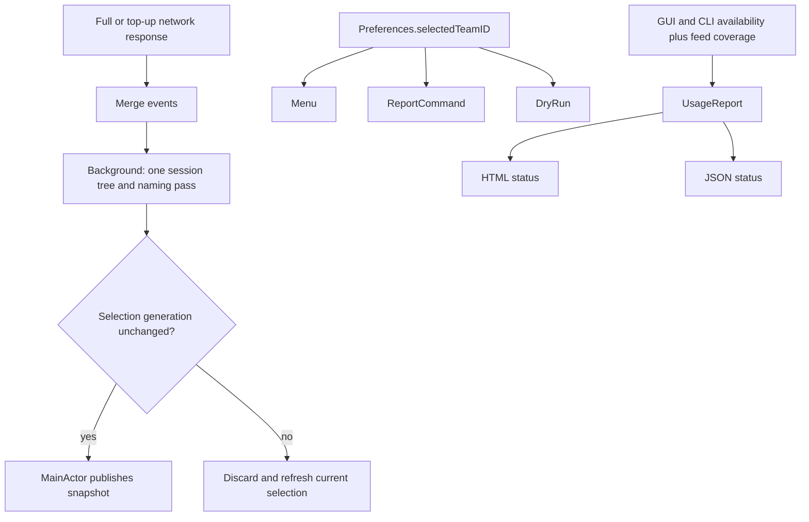

# Refresh Performance and Report Reliability

Status: approved for implementation on 2026-11-10.

## Scope

Three approved work items:

1. Remove duplicate session-tree construction and local name resolution from menu refreshes;
   perform the remaining construction off the main actor.
2. Make the menu, HTML/JSON reports, and `--dry-run` use the same explicit team selection.
3. Make report completeness states truthful for quiet local stores, unreadable local stores,
   and short event-feed responses.

Deferred: faster team discovery (serial team-spend requests), persistent CLI naming caches,
and a broader Usage Report UX/content/performance review.

## Current Problems

- `CursorAPI.fetchSnapshot` resolves a session tree for every full response. `UsageStore`
  then merges the events and synchronously builds another tree, including another naming
  pass, on `@MainActor`. Top-ups therefore also build a partial tree that is discarded.
- `ReportCommand` and `DryRun` call the API without `Preferences.selectedTeamID`, so they use
  automatic team selection even when the menu is explicitly pinned to another team.
- `ActivityDigest.empty` currently represents both a readable store with no activity and an
  unreadable store. HTML calls both cases "local store could not be read" and JSON cannot
  distinguish them.
- Event paging sets `truncated` only when the three-page cap is exhausted. A short response
  whose declared total exceeds the rows returned is presented as complete.

## Design

### 1. One background session build

- Add an internal `CursorAPI.fetchSnapshotForMerge` entry point. It shares the existing
  network implementation but leaves `sessions` empty and performs no naming lookup.
- Keep public `fetchSnapshot` unchanged for reports, dry-run, and existing callers: it still
  returns a fully resolved session tree.
- `UsageStore` uses the merge-oriented entry point for full refreshes. After merging, one
  detached task resolves names and builds the tree from the merged event set. Summary polls
  do not build sessions.
- Recheck `selectionGeneration` after the background work and before mutating merge state or
  publishing. A team switch discards obsolete work and starts the existing replacement pass.
- Do not add a persistent `CliCatalog` cache. Removing the duplicate pass is the approved win;
  a cache would introduce title/new-chat invalidation behavior without evidence it is needed.

### 2. Shared team context

- `MenuContent` passes `Preferences.selectedTeamID` to `ReportCommand.write`.
- `ReportCommand.run` reads the same preference for `--report`; `DryRun` reads it for both
  identity discovery and snapshot fetching.
- `nil` retains the existing `Auto — most usage` behavior. Team selection, fallback, and
  request ordering rules do not change.
- Add narrow internal injection seams at the command boundaries so application tests can use
  the existing transport/database fixtures and assert the actual request bodies.

### 3. Explicit local availability and feed completeness

- `ActivityDigest` gains `unavailableSources: Set<ActivitySource>`, defaulting to empty.
  Consequently `.empty` means a readable, quiet store. Merging digests unions unavailable
  sources without discarding readable data from the other source.
- `ActivityCatalog` marks `.gui` unavailable on database/schema/read failures. `CliCatalog`
  marks `.cli` unavailable when an existing store cannot be enumerated; an absent CLI root
  remains a readable empty state because never using the CLI is normal.
- `UsageReport` carries the unavailable sources. `hasActivity` remains unchanged and still
  describes whether activity rows exist.
- HTML shows a source-specific warning only for unavailable stores. A readable quiet cycle
  gets a neutral no-local-activity note instead of a read-failure warning.
- JSON adds an `activityAvailability` object with explicit `gui` and `cli` states. The schema
  stays `cursor-gauge/report/1`: the change is additive and `hasActivity` keeps its behavior.
- Event paging marks the snapshot truncated whenever the declared event total exceeds the
  collected row count, including a short page before the page cap. Existing top-up recovery
  and full-report partial rendering then work unchanged.

## Invariants

- Full and top-up publishes produce exactly the same events, models, session totals, names,
  and reconciliation buckets as the always-resolve reference path on identical input.
- One menu publish performs at most one naming pass; summary publishes perform none.
- No local session-tree construction or naming I/O runs on the main actor.
- A late result from a previous team never publishes or replaces the current team's merge base.
- Reports always request the whole cycle (`eventsSince: nil`) and never inherit top-up state.
- Prompt text remains opt-in. Availability metadata contains no token, prompt, path, or team
  member data.
- `hasActivity`, JSON schema `cursor-gauge/report/1`, refresh cadence, quiet backoff, overlap,
  and every-tenth-full reconciliation remain unchanged.

## Acceptance

- Tests prove the merge path does not pre-resolve sessions, one naming pass occurs per full
  publish, and naming runs off the main thread.
- Existing merge, truncation recovery, reconciliation, failure, and team-switch tests stay
  green; a gated regression test covers a late result during background resolution.
- Application tests prove explicit and automatic team selection for report and dry-run entry
  points by inspecting recorded API request bodies.
- Fixture tests cover readable-empty, GUI-unavailable, CLI-unavailable, mixed-source data,
  HTML wording, and JSON availability states.
- A short page with a larger declared total produces `partial=true` in JSON and the existing
  partial notice in HTML.
- `swift test` and `swift build` pass on the Mac host. Real-account UI and API behavior is not
  claimed unless a real Cursor installation is actually available for verification.
